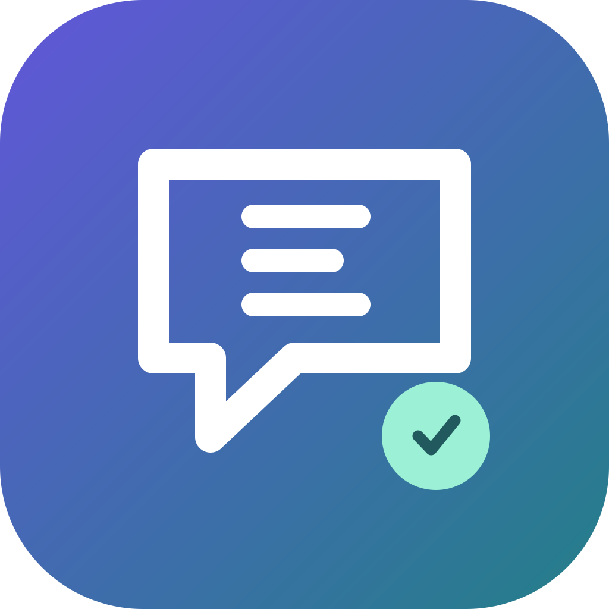

<p align="center"></p>
<h1 align="center">EchoLingo · 回声译</h1>
<p align="center">选中文字，按下快捷键。翻译就在眼前。</p>
<p align="center">Windows 优先 · macOS 支持 · 系统离线 OCR · 自定义翻译 API</p>

**0.1.0 预览版开发中。** 本项目独立实现 Bob 风格的桌面翻译工作流，非 Bob 官方产品，不使用 Bob 专有代码或素材，也不直接兼容 Bob 插件。

## 初版功能

- 在其他应用选中文字后，用全局快捷键取词并翻译。
- 框选屏幕区域，本机 OCR 后翻译；或只识字、静默复制到剪贴板。
- 输入翻译、剪贴板翻译，多服务结果对照。
- 自定义 OpenAI 兼容 API、DeepL、LibreTranslate 的端点、模型、密钥和提示词。
- 本地历史与收藏、搜索/清除、窗口置顶、托盘常驻、深浅主题。
- 原生 WebView + Rust；不捆绑 Chromium 或 OCR 大模型。

## 获取与运行

安装包通过 [GitHub Actions](https://github.com/Blueeeecho/EchoLingo/actions) 构建，验证后的预览版位于 [Releases](https://github.com/Blueeeecho/EchoLingo/releases)。没有附件时说明尚未完成验证，请勿把源代码 ZIP 当安装包。

- Windows：Windows 10 1809+ / Windows 11 x64，需系统 OCR 语言包与 WebView2。安装包可安装缺失的 WebView2（需要联网）。
- macOS：macOS 12+，当前优先 Apple Silicon。取词可能需要辅助功能权限，截图需要屏幕录制权限。原生 helper 的授权与应用本身可能不同，见诊断与 [原生说明](docs/native-testing.md)。
- 初版安装包尚无商业代码签名/Apple 公证，会出现系统来源提示；不包含商店上架或自动更新。

## 首次配置

1. 打开“设置”，选择服务类型并填写 API 地址和模型。OpenAI 兼容服务可填 `https://your-provider.example/v1` 或完整 `/chat/completions` 端点。
2. 填写**自己的** API 密钥。密钥保存到 Windows Credential Manager / macOS Keychain，不写入配置文件。
3. 点击“测试连接”。测试会发送 `Hello`，可能消耗少量供应商 API 额度。应用不附赠翻译额度。
4. 回到其他应用选中文字，按快捷键。扫描 PDF 或图片使用截图翻译。

DeepL 可使用 `https://api-free.deepl.com/v2` 或 Pro 的 `https://api.deepl.com/v2`；LibreTranslate 填你自己的实例地址。本地服务可用 `http://127.0.0.1:端口`，远程服务要求 HTTPS。

## 默认快捷键

| 功能 | Windows | macOS |
|---|---|---|
| 划词翻译 | Alt+D | Option+D |
| 截图翻译 | Alt+S | Option+S |
| 截图 OCR | Alt+Shift+S | Option+Shift+S |
| 静默 OCR 到剪贴板 | Alt+C | Option+C |
| 输入翻译 | Alt+A | Option+A |

设置中可修改或留空禁用。快捷键冲突会报告错误；若同时运行 Bob 等工具，需为其中一个更换快捷键。输入框中 Ctrl/Cmd+Enter 翻译，Esc 取消截图/隐藏窗口。关闭窗口后应用仍在托盘运行，从托盘菜单退出。

## 隐私与数据

OCR 在系统内离线执行，截图为临时文件并在处理结束后删除。翻译会把文本发送给你配置的供应商，因此是否联网、如何处理数据取决于所选服务。无遥测、无常驻剪贴板监听。

历史默认保存在本机，可关闭或清除。密钥位于系统凭据库；其他设置和历史保存在应用数据目录（可在“权限与诊断”查看）。首次配置前请先阅读 [隐私说明](docs/privacy.md)。

## 本地开发

需要 Node.js 24 LTS、Rust stable（1.90+）和平台编译工具。macOS 仅桌面开发使用 Xcode Command Line Tools 即可；Windows 需要 MSVC C++ Build Tools 和 WebView2，详见 [Tauri 官方环境要求](https://v2.tauri.app/start/prerequisites/)。

```sh
npm ci
npm test
npm run build
cargo test --manifest-path src-tauri/Cargo.toml
npm run tauri dev
# 当前平台安装包
npm run tauri build
```

Windows 原生 OCR 非交互自测（不修改剪贴板）：

```powershell
powershell.exe -NoProfile -STA -ExecutionPolicy Bypass -File src-tauri/native/windows.ps1 -Mode self-test
```

## 项目文档

- [项目要求与入口](PROJECT.md)
- [Bob 详细研究与可复现交互](docs/bob-research.zh-CN.md)
- [开发进度](docs/status.md) · [验证报告](docs/test-report.md)
- [个性化需求与路线图](docs/roadmap.zh-CN.md)
- [原生平台说明](docs/native-testing.md)

原图覆盖翻译、连续 OCR、任意插件执行和完整词典功能尚未实现。Windows 多屏、混合 DPI、特定应用选文等必须按报告补真实桌面验收，不能用构建成功替代。

MIT License. Bob、Windows、macOS 及各翻译服务商标归各自所有者。
